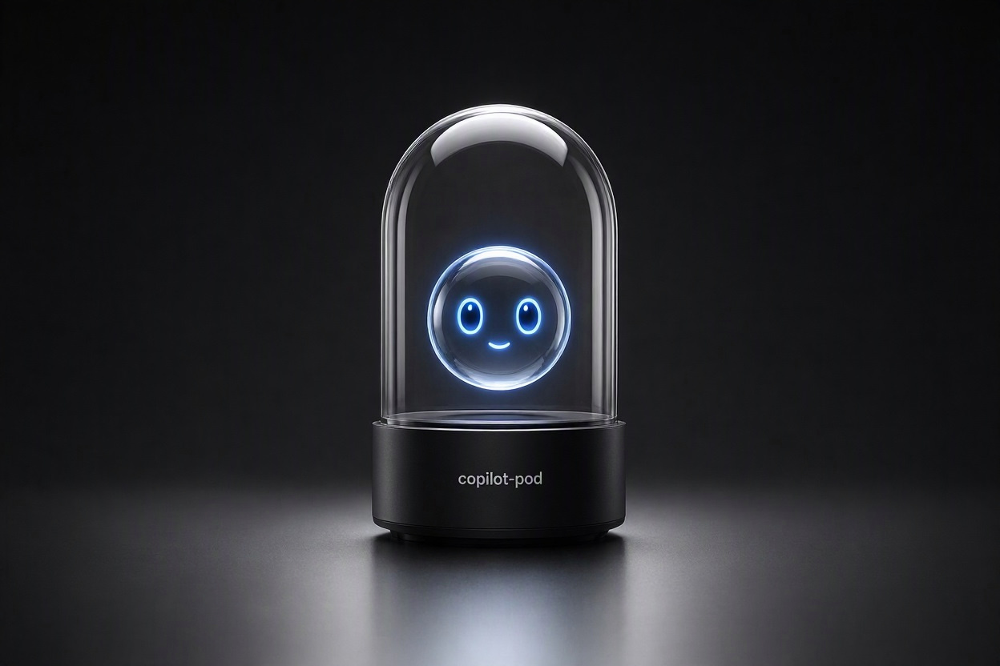

# copilot-pod

> Docker sandbox for the GitHub Copilot CLI. Runs Copilot against one project folder — including with `--yolo` — while your home directory, SSH keys, and other projects stay invisible to the container. Unofficial.



## TL;DR

`copilot-pod` runs Copilot CLI inside a Docker container that mounts the project folder you launch it from. Copilot can read and edit that folder; the rest of your machine — home directory, SSH keys, other projects, host shell — isn't mounted, so the container can't see it.

It's useful in two cases:

- With `--yolo`: you get auto-approval without giving Copilot access to your whole machine.
- In normal, prompt-by-prompt mode: the container still caps the blast radius, so an over-broad command, prompt injection, or a malicious dependency can't reach past the project folder.

It's not full isolation — here's the boundary:

- ✅ **Outside the launch folder is unreachable.** Your home directory, `~/.ssh`, `~/.aws`, other projects, and the host shell aren't mounted, so the container can't see them.
- ⚠️ **Inside the launch folder is fully exposed.** Any `.env`, `.git/config`, or keys in it are readable and writable; outbound network is open, so contents can be read or exfiltrated; and your GitHub/Copilot login is stored on the host under `~/.copilot-pod/`.
- 🚫 **Don't launch from `~` or `/` or other sensitive folders.** That mounts your whole home or filesystem into the container and defeats the point.

The practical effect: the worst case is narrowed from "your whole machine" to "this one folder," which is recoverable from git.

```sh
# Clone this repo once, anywhere you like (~/tools/copilot-pod is just an example)
git clone https://github.com/alfsch/copilot-pod.git ~/tools/copilot-pod

# Build the image (once) — runs from anywhere, no cd needed
~/tools/copilot-pod/install.sh

# cd into your project, then launch Copilot
cd ~/projects/your-project
~/tools/copilot-pod/copilot-pod copilot --yolo

# Long path? You can alias it — see "Aliases" below.

# Forgot a command later? Print a copy-pastable cheatsheet of all of them
~/tools/copilot-pod/copilot-pod --help
```

Docker is the only requirement — no Node.js, npm, or `copilot` needed on your host. For the full threat model and the four-file design, see [Security and limits](#security-and-limits). For the official approach, see GitHub's [Copilot CLI documentation](https://docs.github.com/copilot/how-tos/use-copilot-agents/use-copilot-cli).

## Contents

- [Usage](#usage)
  - [Requirements](#requirements)
  - [Running copilot-pod](#running-copilot-pod)
  - [Aliases](#aliases)
  - [First launch (login)](#first-launch-login)
  - [Exposing ports](#exposing-ports)
  - [Using Docker inside the pod](#using-docker-inside-the-pod)
  - [Pasting images and screenshots](#pasting-images-and-screenshots)
  - [Updating or pinning the Copilot CLI version](#updating-or-pinning-the-copilot-cli-version)
  - [Customizing the image](#customizing-the-image)
- [Security and limits](#security-and-limits)
  - [What it actually does](#what-it-actually-does)
  - [What is and isn't isolated](#what-is-and-isnt-isolated)
  - [Network isolation and resource limits](#network-isolation-and-resource-limits)
  - [Side effects outside the project folder](#side-effects-outside-the-project-folder)
- [Reference](#reference)
  - [Platforms](#platforms)
  - [Uninstall](#uninstall)
  - [License and trademarks](#license-and-trademarks)

## Usage

### Requirements

**Just Docker.** Copilot CLI runs inside the container, not on your host — you do not need Node.js, npm, or the `copilot` CLI installed on your machine. The host stays untouched apart from one state folder (`~/.copilot-pod/`) that exists only to keep your login across container restarts.

### Running copilot-pod

Call the script using its full or relative path from any project:

```sh
cd ~/projects/anything
~/tools/copilot-pod/copilot-pod
```

You land in a bash shell at the same path your project lives at on the host (e.g. `/Users/you/projects/anything`), with `copilot` on `PATH`. Run it however you like:

```sh
copilot --yolo
```

Alternatively, you may skip the shell and go straight into Copilot. Anything you pass to `copilot-pod` is run inside the container instead of bash. So this drops you directly into Copilot in one command, and exits the container when Copilot exits:

```sh
~/tools/copilot-pod/copilot-pod copilot --yolo
```

To exit, type `exit`.

Forgot a command later? Run `~/tools/copilot-pod/copilot-pod --help` (or `-h`) anytime — it prints a copy-pastable cheatsheet of every command (run, install, update, uninstall, options), with the correct absolute paths for your install.

### Aliases

For your convenience, you can add an alias to your shell configuration file (`~/.zshrc`, `~/.bashrc`, etc.):

```sh
alias copilot-pod=~/tools/copilot-pod/copilot-pod
```

This is the shell-first form: `copilot-pod` drops you into the container with `copilot` on `PATH`, so you can run `npm install`, a dev server, or tests and then start `copilot` yourself — all inside the sandbox. The same alias also goes straight into Copilot when you pass the command through: `copilot-pod copilot --yolo`.

### First launch (login)

The first time you start Copilot inside the pod, run `/login` and follow the device-flow prompt: open the printed URL in your host browser and enter the code. The session persists in `~/.copilot-pod/` and survives container restarts — you only do this once per machine.

Alternatively, export `COPILOT_GITHUB_TOKEN`, `GH_TOKEN` or `GITHUB_TOKEN` on the host before launching; `copilot-pod` forwards whichever are set into the container (they also authenticate `gh`). Note that the token is then visible to everything running in the container.

### Exposing ports

By default, `copilot-pod` doesn't publish any ports to the host (outbound traffic is still unrestricted — see [What is and isn't isolated](#what-is-and-isnt-isolated)). Map ports through with the `PORTS` environment variable:

```sh
# Map a single port (127.0.0.1:3000 -> container:3000)
PORTS=3000 copilot-pod

# Map multiple ports
PORTS="3000 5173" copilot-pod

# Map a specific host port to a different container port
PORTS="8080:80" copilot-pod

# Or, alternatively, without using aliases
PORTS="5173:5173" ~/tools/copilot-pod/copilot-pod
```

> **Bind your dev server to `0.0.0.0` inside the container, not `localhost`.** Most dev servers default to `localhost`, which means they only listen on the container's own loopback — your host browser can't reach them even with `PORTS=...` set. Common fixes:
> - **Vite:** `npm run dev -- --host` (or `vite --host 0.0.0.0`)
> - **Next.js:** `next dev -H 0.0.0.0`
> - **Create React App / webpack-dev-server:** `HOST=0.0.0.0 npm start`
> - **Django:** `manage.py runserver 0.0.0.0:8000`
> - **Rails:** `rails s -b 0.0.0.0`
>
> The host-side mapping is still `127.0.0.1`-only (forced by `copilot-pod`), so binding `0.0.0.0` inside the container does not expose your dev server to your LAN.

### Using Docker inside the pod

Set `DOCKER=1` to get a throwaway Docker daemon for the session (build images, run containers, `docker compose`):

```sh
DOCKER=1 copilot-pod
```

How it works: `copilot-pod` starts a separate **rootless Docker-in-Docker sidecar** (`docker:28-dind-rootless`) on a private per-run network and points the pod's `docker` CLI at it. Only the sidecar runs `--privileged`; the pod keeps all its hardening (no capabilities, `no-new-privileges`, default seccomp). The host's Docker socket is never mounted. The sidecar and its network are removed when the session ends, taking its images and containers with it. It works on Linux, macOS and Windows (WSL2).

Things to know:

- The sidecar is privileged (inside Docker's VM on macOS/Windows). A kernel or runtime escape from it would be more serious than from the default pod, so use `DOCKER=1` only on projects you trust.
- The project folder is mounted into the sidecar at the same path, so `docker run -v "$PWD:/app" ...` works. The sidecar runs as uid 1000; if your host uid differs, inner containers may not be able to write to the project.
- Ports published by inner containers are not reachable from the host.
- `DOCKER=1` and `NET=none` are mutually exclusive. `MEMORY`, `CPUS` and `PIDS` apply to the sidecar too. Set `DIND_IMAGE=...` to use a different sidecar image.
- Images are re-pulled every session.

### Pasting images and screenshots

Copilot can only read files that live **inside the project folder** — that's the one directory bind-mounted into the container. Images on your Desktop or in Downloads aren't mounted, so pasting one straight from there hands Copilot a path it can't reach. This is the same isolation that keeps the rest of your machine private from the container ([What is and isn't isolated](#what-is-and-isnt-isolated)); the small bit of friction below is the price for not exposing those default locations.

The workaround:

1. Take the screenshot as usual (it lands on the Desktop, or wherever your OS drops it).
2. Copy the file into your project folder — anywhere under it works, e.g. a `tmp/` subfolder.
3. **Re-copy the file from that new in-project location**, so the path on your clipboard points at the copy that's actually synced into the container.
4. Paste into Copilot. The path now resolves inside the container and the image is recognized.

### Updating or pinning the Copilot CLI version

By default, `install.sh` installs the current official release (npm's `latest` dist-tag). It resolves `latest` to a concrete version first, so Docker's cache is reused until a new release appears. It resolves its own location, so you can re-run it from any folder:

```sh
~/tools/copilot-pod/install.sh
```

To pin a specific version, set `COPILOT_CLI_VERSION`:

```sh
COPILOT_CLI_VERSION=2.0.0 ~/tools/copilot-pod/install.sh
```

To track the newest build instead of the official release, pin to `latest` (always refetched, bypassing Docker's cache):

```sh
COPILOT_CLI_VERSION=latest ~/tools/copilot-pod/install.sh
```

**Automatic updates on start.** If the image was built from the default `latest` channel, every `copilot-pod` start checks npm for a newer release (3-second timeout) and, if there is one, rebuilds the image via `install.sh` before launching. Offline or failed check/rebuild? It prints a note and continues with the existing image. Images pinned to a version are never auto-updated, and neither is an image built before this feature existed — re-run `install.sh` once to opt in. Skip the check for a single run with `COPILOT_POD_NO_UPDATE=1 copilot-pod`.

Pinned versions cache normally across rebuilds. The script prints the resolved version after each build, so you always know what you got.

### Customizing the image

The image is intentionally minimal: `node:24-slim` + `git` + `curl` + `less` + `jq` + `gh` + `yq` + the `docker` CLI (+ compose plugin) + `python3` + `pip` + `venv` + `pdftotext` (poppler-utils) + `qpdf` + `tesseract` (English, German) + Copilot CLI. Nothing project-specific. Anything else your projects need (build tools, other toolchains, more OCR languages) you add yourself — edit the `Dockerfile` and re-run `~/tools/copilot-pod/install.sh`.

## Security and limits

### What it actually does

The whole tool is four tiny files:

- **`Dockerfile`** — `node:24-slim` + `git` + `curl` + `less` + `jq` + `gh` + `yq` + `python3` + `python3-pip` + `python3-venv` + `poppler-utils` + `qpdf` + `tesseract-ocr` (eng, deu) + `@github/copilot`.
- **`copilot-pod`** — one `docker run` command that mounts your current directory (plus a small state dir for login and history) and nothing else of your machine.
- **`install.sh`** — checks Docker and builds the image. Doesn't touch any system path; the tool stays self-contained in this folder.
- **`uninstall.sh`** — removes the image and `~/.copilot-pod/` (auth + session history) after confirmation. Lists what it doesn't touch so you can clean those up yourself.

### What is and isn't isolated

**Safe from Copilot:**
- Everything outside the project folder you launched from. `~/.ssh`, `~/.aws`, `~/.zshrc`, browser data, other projects — all unreachable.
- The host shell. No way to execute commands on your host machine.

**Still exposed:**
- **The project folder itself.** Anything inside it — `.env`, `.git/config` (which can carry credentials for private remotes), private keys committed by mistake, `node_modules`, sibling worktrees, scratch files — is fully readable *and* writable by code running in the container. Don't run `copilot-pod` from a folder whose contents you wouldn't trust the AI (or a malicious dependency it just installed) to see and modify.
- **The network.** Outbound is unrestricted by default. A malicious payload could exfiltrate the project contents or burn your Copilot quota. For offline work you can cut networking entirely with `NET=none` (see [Network isolation and resource limits](#network-isolation-and-resource-limits)), but that also takes Copilot itself offline — there's no built-in egress allowlist that would keep Copilot online while blocking everything else.
- **Your GitHub/Copilot login** (stored in `~/.copilot-pod/` on the host, separate from any host Copilot install, shared across sandboxed projects).

**Where Copilot can actually write** — three paths, all intentional bind mounts:
- The project folder, bind-mounted at the same path inside the container (`$PWD:$PWD`). Edits land on your host's disk directly, no copy.
- `~/.copilot-pod/` on the host, mounted at `/home/copilot-pod/.copilot`. Holds the auth token and session history.
- `~/.copilot-pod/.copilot.json`, mounted at `/home/copilot-pod/.copilot.json`. Holds account binding and project trust state.

> Because the current directory (`$PWD`) is mounted into the container, **avoid running this tool from directories like root (`/`) or `/etc` or other sensitive ones**. In such cases you are giving the AI access to your entire machine or to other sensitive data, defeating the purpose of the sandbox. Always `cd` into your specific project folder first.

Everywhere else Copilot writes is either in the container's ephemeral filesystem (discarded on exit thanks to `--rm`) or simply has no path to land at — the Linux kernel's mount namespace makes any other host directory invisible to the container. Symlinks inside the project folder pointing to `~/.ssh` or `/etc/passwd` appear broken for the same reason: those targets aren't mounted, so the container can't see them.

> **Hardlinks are different.** A hardlink is a second name for an existing inode on the same filesystem. If a file inside your project folder is hardlinked to a sensitive file elsewhere on the same filesystem (e.g., `~/.ssh/id_rsa`), the container *can* reach it through the hardlink — the bind-mount exposes the inode, not just the path. This requires the hardlink to already exist in the project folder, so it's a real concern only when you're inspecting code from an untrusted source. Treat unfamiliar projects with the same caution you'd apply to running their code directly: don't run `copilot-pod` inside a folder you don't trust.

The tradeoff: the worst case becomes "something bad happens to one project folder," which is recoverable from git, instead of "my entire home directory is exposed."

### Network isolation and resource limits

By default the container has **unrestricted outbound network** (Copilot needs `the GitHub Copilot API`, your builds need npm/pip/etc.) and a generous process cap. When you're about to let Copilot loose on code from an untrusted source, you can tighten things further with environment variables — all of them just add flags to the same `docker run`, nothing else changes:

```sh
# Cut ALL networking for the run. A malicious payload can't exfiltrate the project or phone home.
# Note: Copilot itself can't reach GitHub with no network, so this is for offline shell/build
# work (inspecting or building untrusted code), not for a live Copilot session.
NET=none copilot-pod

# Cap memory and CPU so a runaway or malicious build can't exhaust the host (recoverable via OOM,
# but disruptive). No default cap — a fixed limit would kill legitimate large builds.
MEMORY=4g CPUS=2 copilot-pod

# Lower the process/thread cap when running untrusted code (default is 4096, generous for builds).
PIDS=512 copilot-pod
```

`NET=none` and `PORTS` are mutually exclusive — a container with no network can't publish ports. `--pids-limit` is always applied (it contains fork bombs, which dropped capabilities do *not* prevent); raise `PIDS=` if a very parallel build hits the ceiling.

### Side effects outside the project folder

Everything this repo causes to exist outside the project you launch it from:

- `~/.copilot-pod/` on your host — auth token, settings, and per-project session/conversation history (transcripts can include code snippets and command output Copilot saw). Auth and settings are shared across projects (one login, ever); session history lives under `~/.copilot-pod/session-state/`, and account/trust state in `~/.copilot-pod/.copilot.json`. This is *not* a host Copilot install; it's a state directory for the container's Copilot, kept on the host so it survives restarts.
- Docker image `copilot-pod` and its layers, plus the `node:24-slim` base image, in Docker's image store.
- Docker build cache from `apt-get` and `npm install` steps.
- Outbound network during build: Docker Hub, Debian apt mirrors, npm registry. During runtime: `the GitHub Copilot API` and whatever your project code reaches (network is unrestricted).
- While a session is running: one container process, and any ports you explicitly mapped via `PORTS` bound on `127.0.0.1`.

No `sudo`, no writes to `/usr/local/`, `/etc/`, `~/.zshrc`, `~/Library/`, your existing `~/.copilot/`, or anywhere else on the host.

## Reference

### Platforms

The wrapper is portable POSIX bash + Docker. It should work on any host with a recent Docker:

- **macOS** (Apple Silicon and Intel) with Docker Desktop, OrbStack, or Colima — primary development target.
- **Linux** with Docker Engine or Docker Desktop — bind mounts and `--user` UID/GID map directly here, the most native experience.
- **Windows + WSL2** with Docker Desktop's WSL2 backend — run `copilot-pod` from inside a WSL distribution's bash shell.

**Native Windows** (`cmd.exe` / PowerShell) is not supported. The wrapper is a bash script and uses POSIX tools (`id`, etc.); use WSL2 instead.

If a platform doesn't behave as expected, please open an issue.

### Uninstall

```sh
~/tools/copilot-pod/uninstall.sh
```

Removes `~/.copilot-pod/` and the `copilot-pod` image after confirmation. Tells you exactly what it isn't touching (`node:24-slim`, build cache, this repo) and how to clean those up yourself.

If you added a shell alias for convenience (e.g. `alias copilot-pod=...` in `~/.zshrc` / `~/.bashrc`), remove that line too — `uninstall.sh` doesn't touch your shell rc files.

### License and trademarks

The code in this repository is released under the MIT License — see [`LICENSE`](LICENSE) for the full text. This project is derived from [trekhleb/claude-pod](https://github.com/trekhleb/claude-pod) by Oleksii Trekhleb (MIT), adapted for the GitHub Copilot CLI. The cover image was generated with AI (Microsoft Bing Image Creator).

Copilot CLI itself is a separate product owned by GitHub, Inc. (Microsoft), and is **not** redistributed by this project — `install.sh` fetches it from npm at build time. This project is not affiliated with, endorsed by, or sponsored by GitHub or Microsoft. "GitHub" and "Copilot" are trademarks of GitHub, Inc. / Microsoft, referenced here nominatively. No GitHub or Microsoft logos, wordmarks, or other brand assets are used.
